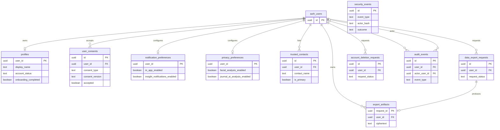
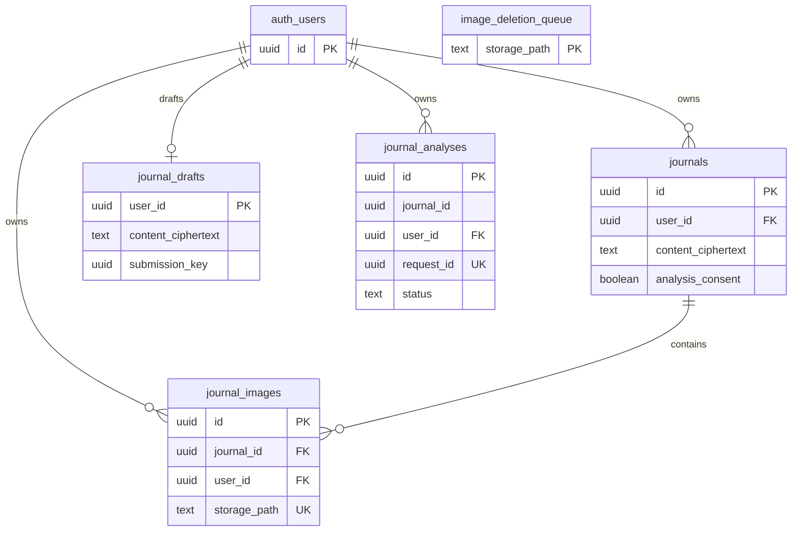
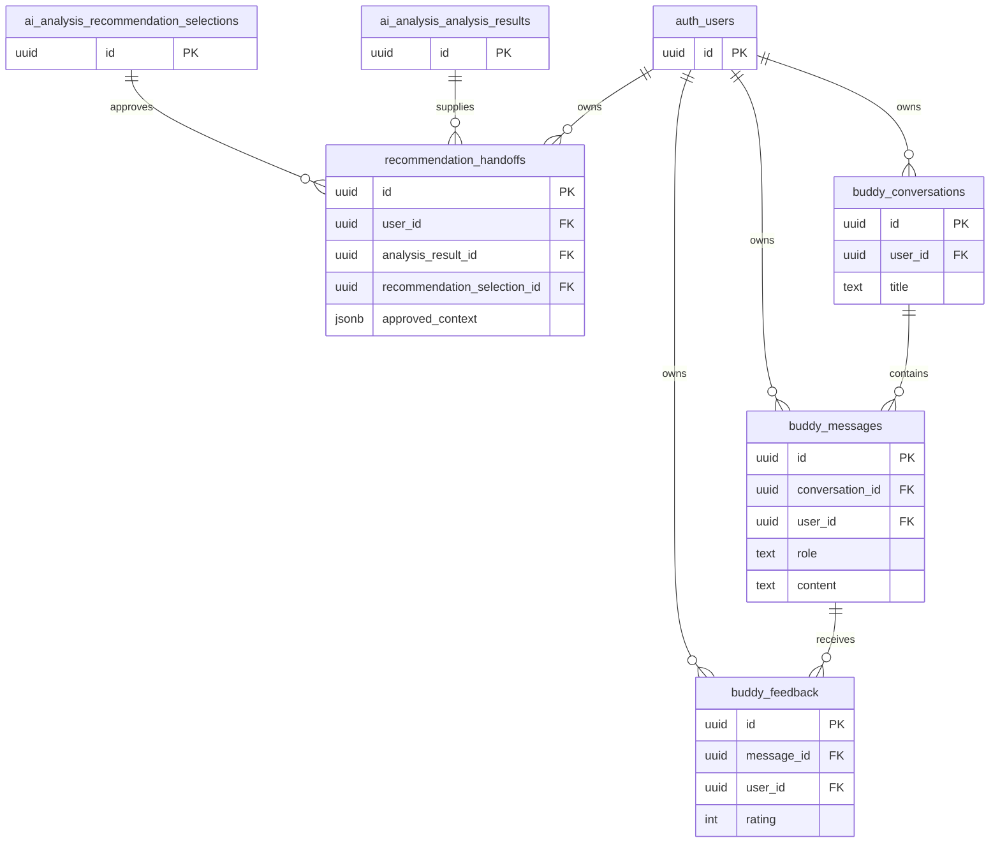
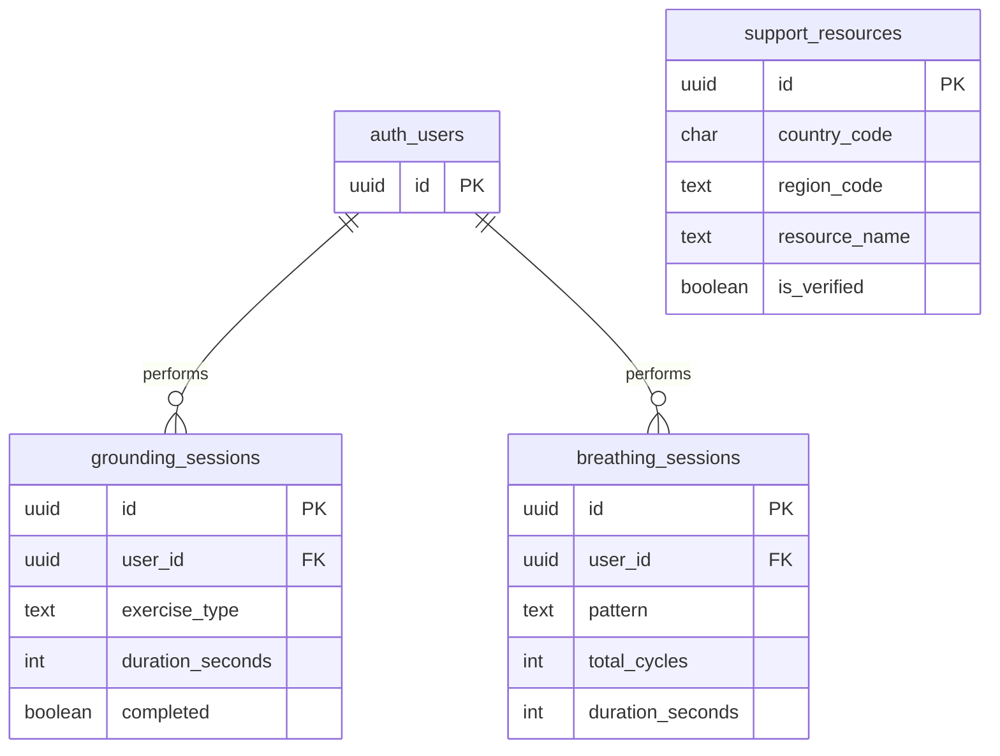
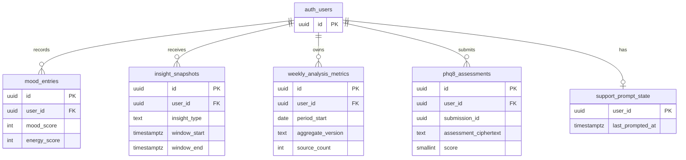
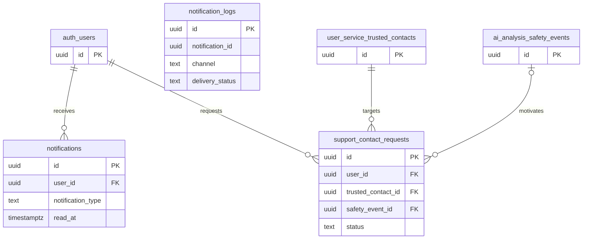
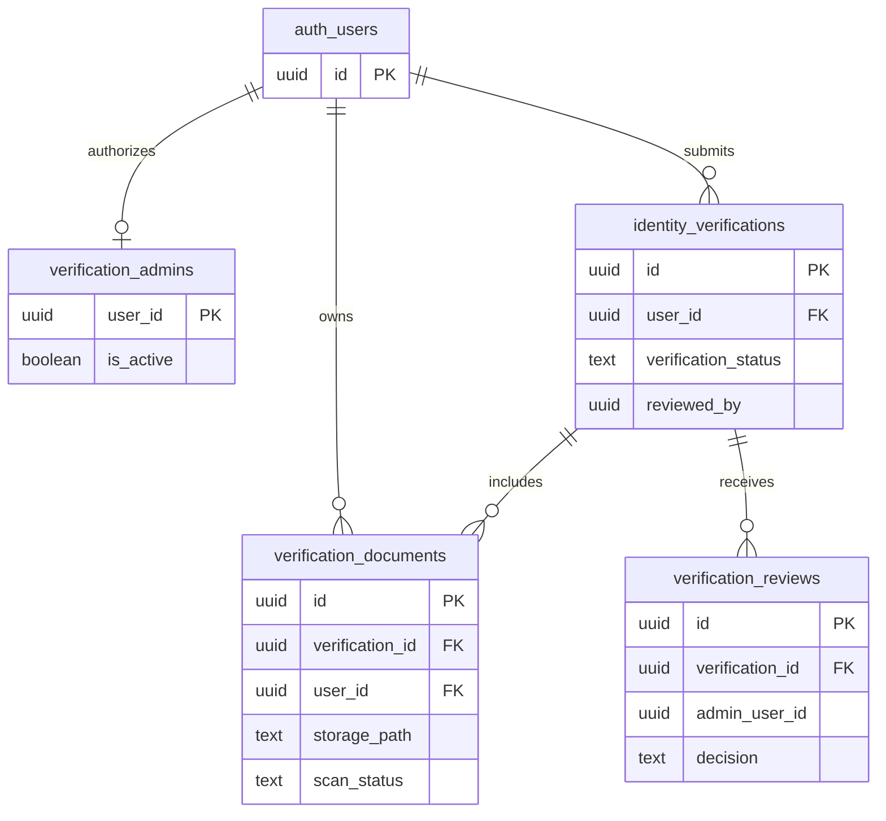
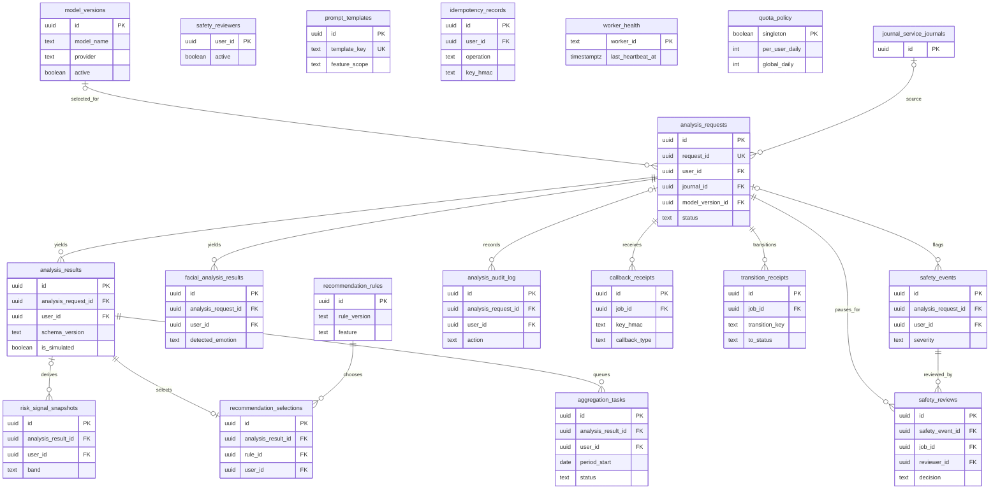
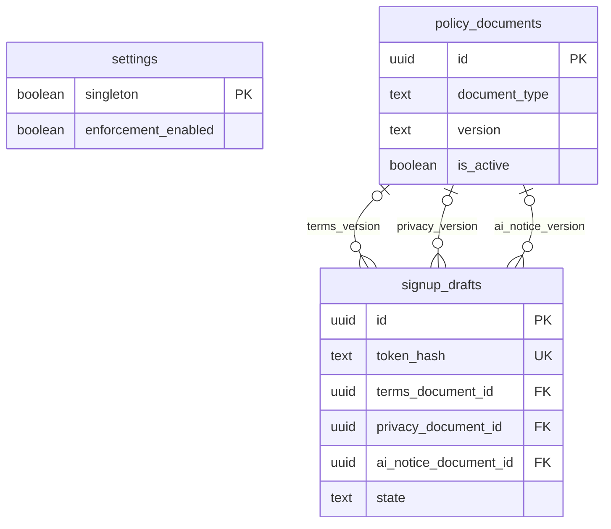

# Echo service-schema ERDs

**Repository design as of 6 October 2026.** These nine figures cover the 55 tables in the seven `*_service` schemas and the supporting `ai_analysis` and `auth_provisioning` schemas. They are based on the chronological SQL in `supabase/migrations/`, checked against the repository's **synthetic**, isolated PostgreSQL catalog at `docs/security/DATABASE_CATALOG.json`. They are not a live database inspection. The boxes show selected columns; consult the migrations for complete columns, constraints, indexes, and policies.

Each line represents a **declared foreign key**. `auth_users` means Supabase-managed `auth.users`; other schema-qualified names written with underscores are external tables. A column marked `FK` can be part of a composite foreign key. Tables without lines have no declared relationship to another table shown in that figure. Several foreign keys are `NOT VALID` in the catalog: PostgreSQL enforces them for new changes but historical rows still need validation. The figure notes call out important logical links that are **not** foreign keys. These are logical schemas within one PostgreSQL database, not separately deployed microservices.

## Figure 4.1 — User Service Schema (`user_service`)

`security_events` uses hashed request/actor information and has no account foreign key. The `user_id` links above point to `auth.users`, not to `user_service.profiles`.

## Figure 4.2 — Journal Service Schema (`journal_service`)

`journal_analyses.journal_id` identifies a journal but has **no declared FK** to `journals`. Its `request_id` is unique but has no declared FK to `ai_analysis.analysis_requests`. `image_deletion_queue.storage_path` is likewise not a foreign key to `journal_images.storage_path`. The catalog lists the `journal_analyses.user_id` FK as `NOT VALID`.

## Figure 4.3 — Buddy Service Schema (`buddy_service`)

The message-to-conversation and feedback-to-message links use composite FKs that include `user_id`, so ownership must match. The catalog lists those composite FKs and the account FKs on conversations, messages, and feedback as `NOT VALID`. The ERD describes storage relationships; it does not establish that Buddy uses a trained conversational model.

## Figure 4.4 — Grounding Service Schema (`grounding_service`)

`support_resources` is an independent reviewed directory. The two session-to-account FKs are `NOT VALID` in the catalog.

## Figure 4.5 — Insights Service Schema (`insights_service`)

The unique key on `phq8_assessments` is **composite** `(user_id, submission_id)`; `submission_id` alone is not declared unique. Weekly metrics are derived from analysis data but have no FK to an `ai_analysis` table. `mood_entries` and `insight_snapshots` account FKs are `NOT VALID` in the catalog. A PHQ-8 assessment is a user's questionnaire submission, not a model prediction.

## Figure 4.6 — Notification Service Schema (`notification_service`)

Although `notification_logs.notification_id` is used as a logical link to `notifications.id`, **no FK is declared** between them. `notifications.user_id` is a `NOT VALID` FK in the catalog. The safety event link is nullable.

## Figure 4.7 — Verification Service Schema (`verification_service`)

The document-to-verification FK is composite `(verification_id, user_id)` and is `NOT VALID`. The review-to-verification FK is also `NOT VALID`. `identity_verifications.reviewed_by` and `verification_reviews.admin_user_id` identify reviewers but have **no declared FKs** to `verification_admins` in this schema.

## Figure 4.8 — AI Analysis Schema (`ai_analysis`)

The diagram emphasizes the analysis workflow. Account FKs to `auth.users` also exist on `analysis_requests`, `analysis_results`, `facial_analysis_results`, `risk_signal_snapshots`, `safety_events`, `safety_reviews.reviewer_id`, `safety_reviewers`, `analysis_audit_log`, `idempotency_records`, `recommendation_selections`, and `aggregation_tasks`; they are omitted from this dense figure. The `facial_analysis_results` and `risk_signal_snapshots` account FKs are `NOT VALID`. `safety_reviewers` authorizes reviewers, but `safety_reviews.reviewer_id` references `auth.users`, not that table. `prompt_templates`, `idempotency_records`, `worker_health`, and `quota_policy` have no declared intra-schema FKs. The existence of facial and model tables does not establish deployed, validated AI inference.

## Figure 4.9 — Authentication Provisioning Schema (`auth_provisioning`)

`policy_documents` has a composite unique key `(document_type, version)`. `settings` is a standalone singleton. The repository migration initially created provisioning enforcement disabled, so deployment-specific enforcement requires a target-database check.

## Cross-schema status projection

`public.analysis_status_projection` is a small, owner-readable progress table, **not** another service schema. Its `job_id` primary key references `ai_analysis.analysis_requests.id`; `journal_id` references `journal_service.journals.id`; and `user_id` references `auth.users.id`. Legacy `public` tables are omitted because the service tables above are the canonical domain grouping described in the reference. Check the target database before calling these figures deployed ERDs.
